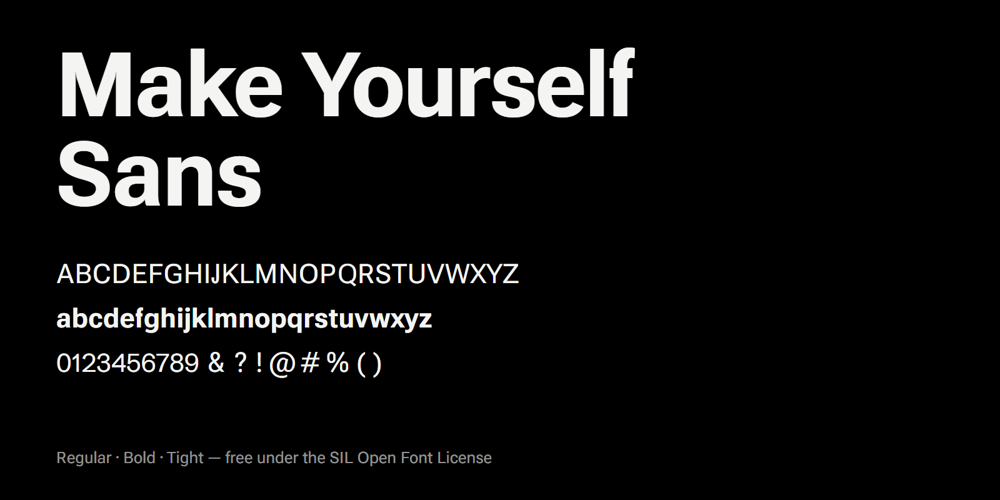

# Make Yourself Sans



The typeface of the [Make Yourself](https://makeyourself.app) app. A clean grotesque in Regular and Bold, free for personal and commercial use.

**[Try it live](https://makeyourself.app/font)** · **[Download the family (.zip)](https://github.com/MakeYourselfApp/make-yourself-sans/releases/latest/download/MakeYourselfSans-Family.zip)**

## What is inside

| Family | Styles | Spacing |
| --- | --- | --- |
| Make Yourself Sans | Regular, Bold | normal |
| Make Yourself Sans Tight | Regular, Bold | the tighter spacing the app itself uses |

- `fonts/ttf` — desktop fonts
- `fonts/webfonts` — WOFF2 for the web

## Install

- **Windows:** select the `.ttf` files, right-click, Install.
- **macOS:** double-click each `.ttf` file, then Install Font.
- **Linux:** copy the `.ttf` files to `~/.local/share/fonts` and run `fc-cache`.

## Use on the web

```css
@font-face {
  font-family: "Make Yourself Sans";
  src: url("MakeYourselfSans-Regular.woff2") format("woff2");
  font-weight: 400;
  font-display: swap;
}
@font-face {
  font-family: "Make Yourself Sans";
  src: url("MakeYourselfSans-Bold.woff2") format("woff2");
  font-weight: 700;
  font-display: swap;
}
body { font-family: "Make Yourself Sans", system-ui, sans-serif; }
```

## Licence

[SIL Open Font License 1.1](OFL.txt). You may use it, share it and change it. You may not sell the font files on their own.

Make Yourself Sans is a modified version of [Roboto Flex](https://github.com/TypeNetwork/Roboto-Flex) (letters and symbols) and [Schibsted Grotesk](https://github.com/schibsted/schibsted-grotesk) (digits), both under the same licence.
